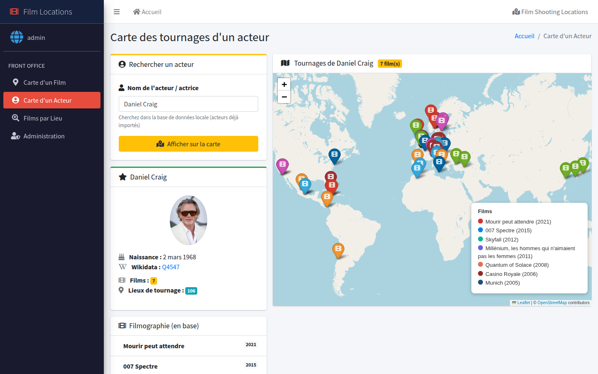
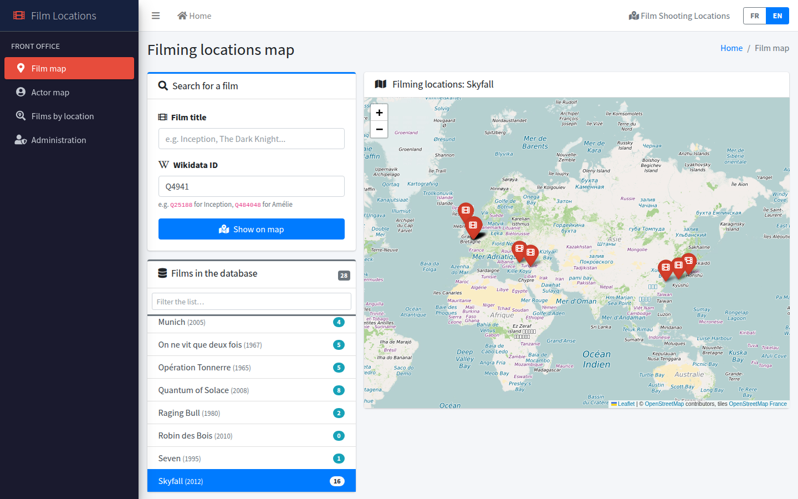
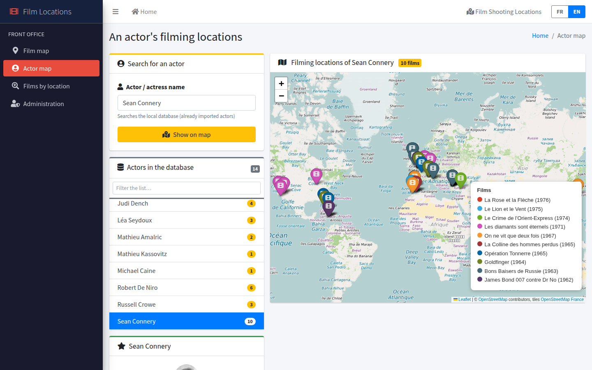
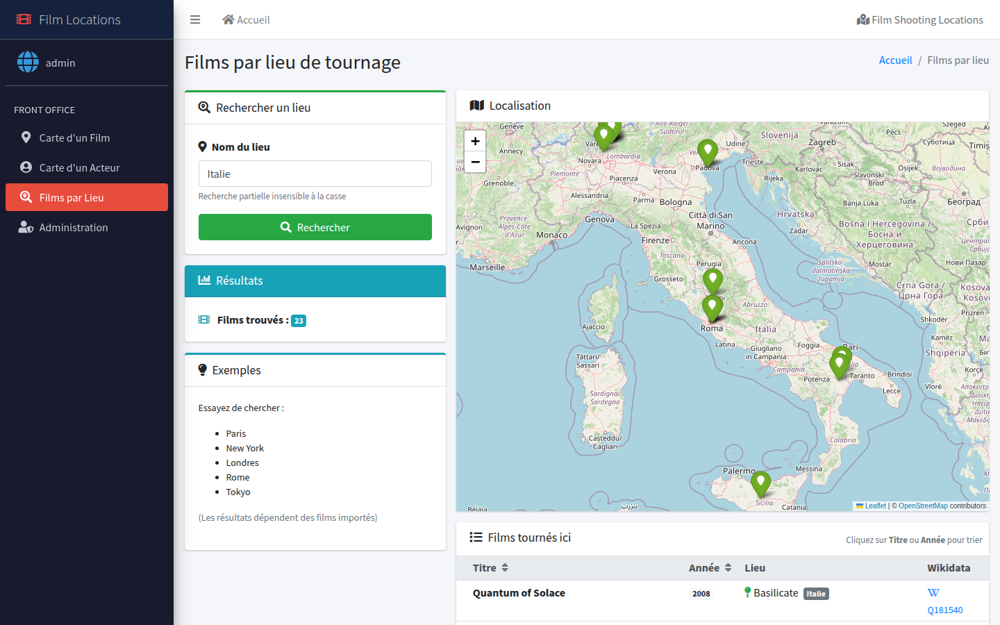
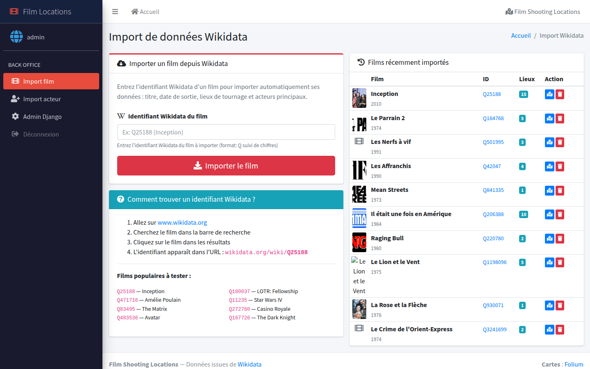

# 🎬 Film Locations

**Explore where movies were shot and follow an actor's filming locations around the world on an interactive map.**

Film Locations is a Django web application that imports film and actor data from [Wikidata](https://www.wikidata.org) (via SPARQL), stores it locally, and displays filming locations on interactive [Folium](https://python-visualization.github.io/folium/) / Leaflet maps.



---

## ✨ Features

### Public pages (front office)

| Page | What it does |
|------|--------------|
| **Film map** (`/film-map/`) | Search a film by title or Wikidata ID and see all its filming locations on a map, with release date, location list and coordinates. |
| **Actor map** (`/actor-map/`) | Search an actor and see the locations of **all their films** on a single map. Each film gets its own marker color, with a legend, filmography and stats (number of films and locations). |
| **Films by location** (`/location-films/`) | Search a place or a country (e.g. *Rome*, *Italy*) and list every film shot there, with a map and a sortable table. |

All search fields have **autocomplete** backed by the local database.

### Admin pages (back office, login required)

| Page | What it does |
|------|--------------|
| **Film import** (`/admin-import/`) | Import a film from its Wikidata ID (e.g. `Q25188` for *Inception*). Fetches the title, release date, poster and filming locations with GPS coordinates and country. Cast members already in the database are linked automatically. |
| **Actor import** (`/actor-import/`) | Import an actor from their Wikidata ID (e.g. `Q4547` for *Daniel Craig*). Fetches the name, birth date and photo, then links the actor to every film already in the database where they appear in the Wikidata cast. |
| **Django admin** (`/admin/`) | Full CRUD on films, actors, locations and film–actor links. |

---

## 📸 Screenshots

### Filming locations of a film
*Skyfall: London, Istanbul, Shanghai, Scotland…*



### Filming locations of an actor
*Sean Connery: 10 films and 58 locations, one color per film*



### Films shot in a given place
*Every film in the database shot in Italy*



### Importing data from Wikidata


---

## 🛠️ Tech stack

- **Backend:** Python 3.12, Django 6
- **Data source:** Wikidata SPARQL endpoint via [SPARQLWrapper](https://github.com/RDFLib/sparqlwrapper)
- **Maps:** Folium (Leaflet.js) with OpenStreetMap tiles
- **UI:** AdminLTE 3, Bootstrap, Font Awesome, django-crispy-forms
- **Database:** SQLite

### Wikidata properties used

| Property | Meaning |
|----------|---------|
| `P915` | filming location |
| `P625` | coordinate location |
| `P17`  | country |
| `P577` | publication date |
| `P161` | cast member |
| `P18` / `P154` | image / logo (poster, actor photo) |
| `P569` | date of birth |

Labels are retrieved in French first, then English.

---

## 🗂️ Data model

```
Film ──< ShootingLocation          (name, latitude, longitude, country)
  │
  └──< FilmActor >── Actor         (many-to-many through FilmActor)
```

- `Film`: `wikidata_id`, `title`, `release_date`, `poster_url`
- `Actor`: `wikidata_id`, `name`, `birth_date`, `photo_url`
- `ShootingLocation`: one row per (location, film) pair
- `FilmActor`: link table between films and actors

Film–actor links are built **in both directions**: when you import a film, actors already in the database are linked; when you import an actor, films already in the database are linked. So the import order doesn't matter.

---

## 🚀 Getting started

```bash
# 1. Clone the repository
git clone https://github.com/arribo44/film-locations.git
cd film-locations

# 2. Create a virtual environment and install dependencies
python3 -m venv venv
source venv/bin/activate
pip install -r requirements.txt

# 3. Create the database and load the demo data
python manage.py migrate
python manage.py loaddata demo

# 4. Create an admin account (needed for the import pages)
python manage.py createsuperuser

# 5. Run the development server
python manage.py runserver
```

Then open <http://127.0.0.1:8000/>.

> The demo fixture (`locations/fixtures/demo.json`) holds 27 films (James Bond, Scorsese/De Niro classics, *Inception*, *Gladiator*…), 14 actors and 200+ filming locations, so the maps work right away. It contains no user accounts.

### Configuration

Settings are read from environment variables:

| Variable | Default | Description |
|----------|---------|-------------|
| `DJANGO_SECRET_KEY` | dev-only key (when `DEBUG` is on) | **Required** in production |
| `DJANGO_DEBUG` | `1` | Set to `0` in production |
| `DJANGO_ALLOWED_HOSTS` | `localhost,127.0.0.1` | Comma-separated host names |

Generate a key with:

```bash
python -c "from django.core.management.utils import get_random_secret_key; print(get_random_secret_key())"
```

### Typical workflow

1. Log in and go to **Import film**, then import a few films by Wikidata ID (for example `Q4941` *Skyfall*, `Q151904` *Casino Royale*, `Q25188` *Inception*).
2. Go to **Import actor** and import an actor (for example `Q4547` *Daniel Craig*). The app links them to the matching films.
3. Open **Actor map** and search *Daniel Craig* to see all their filming locations on one map.

> 💡 To find a Wikidata ID, search for the film or actor on [wikidata.org](https://www.wikidata.org). The ID is the `Q…` code in the URL.

---

## 📁 Project structure

```
FILM_LOCATIONS/
├── film_locations/          # Django project (settings, root URLs, WSGI/ASGI)
├── locations/               # Main app
│   ├── models.py            # Film, Actor, FilmActor, ShootingLocation
│   ├── views.py             # Map views, import views, autocomplete endpoints
│   ├── wikidata_service.py  # SPARQL queries against Wikidata
│   ├── forms.py             # Search & import forms (Wikidata ID validation)
│   ├── admin.py             # Django admin configuration
│   ├── fixtures/demo.json   # Demo data (films, actors, locations)
│   └── urls.py
├── templates/               # AdminLTE-based templates
│   ├── base.html
│   └── locations/
├── static/
├── docs/screenshots/        # Images used in this README
└── requirements.txt
```

---

## ⚠️ Limitations & notes

- The coverage depends on Wikidata: some films have no `P915` (filming location) or no coordinates for their locations. Those locations are listed but not shown on the map.
- Searches run on the **local database** only. A film or actor must be imported before it can be searched.
- This is an educational project, run with Django's development server. See [Configuration](#configuration) before any deployment.
- The UI is in French.

---

## 📜 License & credits

- Film and actor data: [Wikidata](https://www.wikidata.org) (CC0)
- Map tiles: © [OpenStreetMap](https://www.openstreetmap.org/copyright) contributors
- Images: Wikimedia Commons (individual licenses apply)
