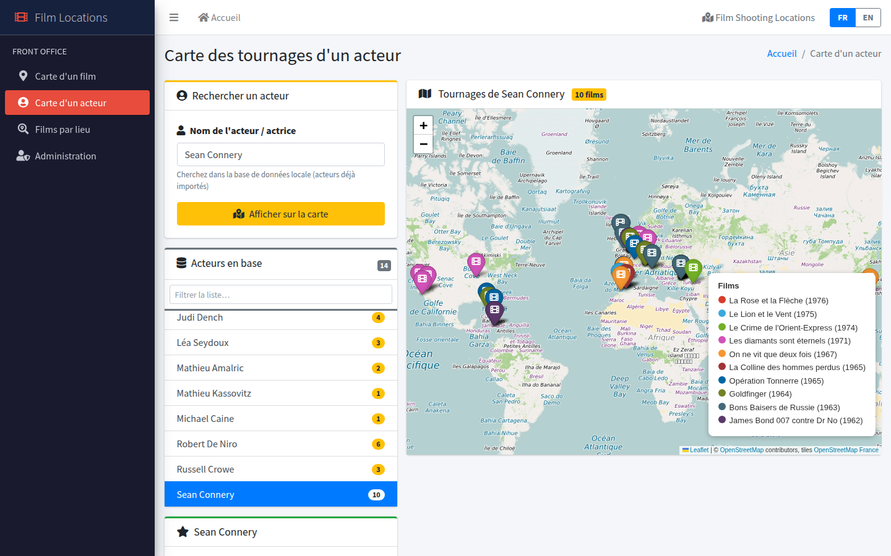

# 🎬 Film Locations

**Explore where movies were shot and follow an actor's filming locations around the world on an interactive map.**

Film Locations is a Django web application that imports film and actor data from [Wikidata](https://www.wikidata.org) (via the Wikibase API), stores it locally, and displays filming locations on interactive [Folium](https://python-visualization.github.io/folium/) / Leaflet maps. The interface is available in **English and French**.


---

## ✨ Features

### Public pages (front office)

| Page | What it does |
|------|--------------|
| **Film map** (`/film-map/`) | Pick a film from the list, or search by title or Wikidata ID, to see all its filming locations on a map, with release date, poster and the list of locations with coordinates. |
| **Actor map** (`/actor-map/`) | Pick an actor to see the locations of **all their films** on a single map. Each film gets its own marker color, listed in a legend inside the map, with the actor's filmography and a film counter in the map title. |
| **Films by location** (`/location-films/`) | Pick a location, or search a place or a country (e.g. *Rome*, *Italie*), to see every film shot there. Each film gets its own color in the map legend; a location shared by several films gets a black marker whose popup lists them all. |

On every map page:

- **Browse what's in the database:** a side list shows every film, actor or location already imported, with a counter (locations per film, films per actor, films per location). Click an entry to show it on the map; the current one is highlighted.
- **Filter as you type:** each list has a filter box that ignores accents and case (`millenium` finds *Millénium*, `italie` keeps only Italian locations).
- **Autocomplete** on the search fields, backed by the local database.
- **FR / EN switch** in the top-right corner. The choice is remembered for the session; on a first visit the browser's language is used.

### Admin pages (back office, login required)

| Page | What it does |
|------|--------------|
| **Film import** (`/admin-import/`) | Import a film from its Wikidata ID (e.g. `Q25188` for *Inception*). Fetches the title, release date, poster and filming locations with GPS coordinates and country. Cast members already in the database are linked automatically. |
| **Actor import** (`/actor-import/`) | Import an actor from their Wikidata ID (e.g. `Q4547` for *Daniel Craig*). Fetches the name, birth date and photo, then links the actor to every film already in the database where they appear in the Wikidata cast. |
| **Django admin** (`/admin/`) | Full CRUD on films, actors, locations and film–actor links. |

Both import pages list the **recently imported** films or actors, most recent import first, with three actions per row: show on the map, **re-import from Wikidata** (↻), and delete.

A re-import updates the record with the current Wikidata values and adds any new locations or film–actor links. An empty value on Wikidata never erases data already stored (poster, date, coordinates, country…).

---

## 📸 Screenshots

### Filming locations of a film
*Skyfall: London, Scotland, Istanbul, Shanghai… picked from the list of films in the database*


### Filming locations of an actor
*Sean Connery: 10 films, one color per film, with the legend inside the map*


### Films shot in a given place
*Every film in the database shot in Italy, with the film legend and counter*


### Importing data from Wikidata
*Recently imported films with the map, re-import and delete actions*


### Bilingual interface
*The same actor map in French, switched with the FR / EN buttons*



---

## 🛠️ Tech stack

- **Backend:** Python 3.12, Django 6
- **Data source:** Wikidata [Wikibase API](https://www.wikidata.org/w/api.php) (`wbgetentities`) via `requests`, with automatic retry on rate limiting (HTTP 429)
- **Maps:** Folium (Leaflet.js) with [OpenStreetMap France](https://www.openstreetmap.fr) tiles
- **UI:** AdminLTE 3, Bootstrap, Font Awesome, django-crispy-forms
- **Translations:** Django i18n (French source strings, English catalog in `locale/en/`)
- **Database:** SQLite

### Wikidata properties used

| Property | Meaning |
|----------|---------|
| `P915` | filming location |
| `P625` | coordinate location |
| `P17`  | country |
| `P297` | ISO country code (a location that is itself a country) |
| `P577` | publication date |
| `P161` | cast member |
| `P18` / `P154` | image / logo (poster, actor photo) |
| `P569` | date of birth |

Only "truthy" statements are used (preferred rank if any, otherwise normal rank; deprecated statements are ignored). Labels are retrieved in French first, then English.

---

## 🗂️ Data model

```
Film ──< ShootingLocation          (name, latitude, longitude, country)
  │
  └──< FilmActor >── Actor         (many-to-many through FilmActor)
```

- `Film`: `wikidata_id`, `title`, `release_date`, `poster_url`, `created_at`, `updated_at`
- `Actor`: `wikidata_id`, `name`, `birth_date`, `photo_url`, `updated_at`
- `ShootingLocation`: one row per (location, film) pair
- `FilmActor`: link table between films and actors

`updated_at` holds the date of the last import or re-import; the "recently imported" lists are sorted by it.

Film–actor links are built **in both directions**: when you import a film, actors already in the database are linked; when you import an actor, films already in the database are linked. So the import order doesn't matter.

---

## 🚀 Getting started

```bash
# 1. Clone the repository
git clone https://github.com/arribo44/film-locations.git
cd film-locations

# 2. Create a virtual environment and install dependencies
python3 -m venv venv
source venv/bin/activate
pip install -r requirements.txt

# 3. Create the database and load the demo data
python manage.py migrate
python manage.py loaddata demo

# 3b. (Optional) Rebuild translations after editing locale/en/LC_MESSAGES/django.po
python manage.py compilemessages -l en --ignore=venv

# 4. Create an admin account (needed for the import pages)
python manage.py createsuperuser

# 5. Run the development server
python manage.py runserver
```

Then open <http://127.0.0.1:8000/>.

> The demo fixture (`locations/fixtures/demo.json`) holds 27 films (James Bond, Scorsese/De Niro classics, *Inception*, *Gladiator*…), 14 actors and 200+ filming locations, so the maps work right away. It contains no user accounts.

### Configuration

Settings are read from environment variables:

| Variable | Default | Description |
|----------|---------|-------------|
| `DJANGO_SECRET_KEY` | dev-only key (when `DEBUG` is on) | **Required** in production |
| `DJANGO_DEBUG` | `1` | Set to `0` in production |
| `DJANGO_ALLOWED_HOSTS` | `localhost,127.0.0.1` | Comma-separated host names |

Generate a key with:

```bash
python -c "from django.core.management.utils import get_random_secret_key; print(get_random_secret_key())"
```

### Typical workflow

1. Log in and go to **Import film**, then import a few films by Wikidata ID (for example `Q4941` *Skyfall*, `Q151904` *Casino Royale*, `Q25188` *Inception*).
2. Go to **Import actor** and import an actor (for example `Q4547` *Daniel Craig*). The app links them to the matching films.
3. Open **Actor map** and click *Daniel Craig* in the list to see all their filming locations on one map.
4. Later, use the ↻ button in the "recently imported" lists to refresh a film or actor from Wikidata.

> 💡 To find a Wikidata ID, search for the film or actor on [wikidata.org](https://www.wikidata.org). The ID is the `Q…` code in the URL.

---

## 📁 Project structure

```
FILM_LOCATIONS/
├── film_locations/          # Django project (settings, root URLs, WSGI/ASGI)
├── locations/               # Main app
│   ├── models.py            # Film, Actor, FilmActor, ShootingLocation
│   ├── views.py             # Map views, import views, autocomplete endpoints
│   ├── wikidata_service.py  # Wikidata API calls (films, actors, locations)
│   ├── forms.py             # Search & import forms (Wikidata ID validation)
│   ├── admin.py             # Django admin configuration
│   ├── migrations/
│   ├── fixtures/demo.json   # Demo data (films, actors, locations)
│   └── urls.py
├── locale/en/LC_MESSAGES/   # English translations (django.po / django.mo)
├── templates/               # AdminLTE-based templates
│   ├── base.html            # Layout, sidebar, list filter script
│   ├── includes/            # FR / EN language switch
│   └── locations/           # One template per page
├── static/
├── docs/screenshots/        # Images used in this README
└── requirements.txt
```

---

## ⚠️ Limitations & notes

- The coverage depends on Wikidata: some films have no `P915` (filming location) or no coordinates for their locations. Those locations are listed but not shown on the map.
- Searches run on the **local database** only. A film or actor must be imported before it can be searched.
- Wikidata may rate-limit requests (HTTP 429). The app waits and retries automatically when asked to wait up to 30 seconds; beyond that, the import shows an error and can simply be retried later.
- Map tiles come from OpenStreetMap France. The main `tile.openstreetmap.org` servers block requests without a `Referer` header, which Firefox never sends from a local page (`127.0.0.1` / `localhost`).
- Film titles and place names come from Wikidata and are stored in French, including when the interface is in English.
- This is an educational project, run with Django's development server. See [Configuration](#configuration) before any deployment.

---

## 📜 License & credits

- Film and actor data: [Wikidata](https://www.wikidata.org) (CC0)
- Map data: © [OpenStreetMap](https://www.openstreetmap.org/copyright) contributors; tiles by [OpenStreetMap France](https://www.openstreetmap.fr)
- Images: Wikimedia Commons (individual licenses apply)
